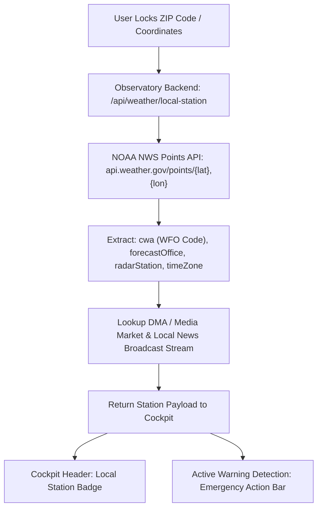
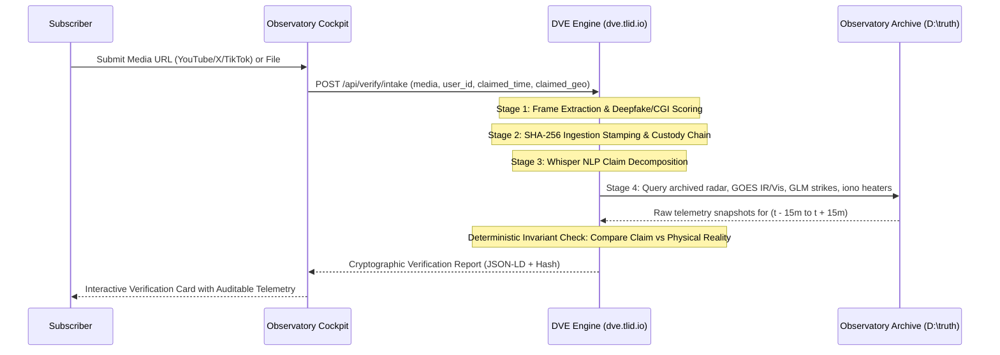
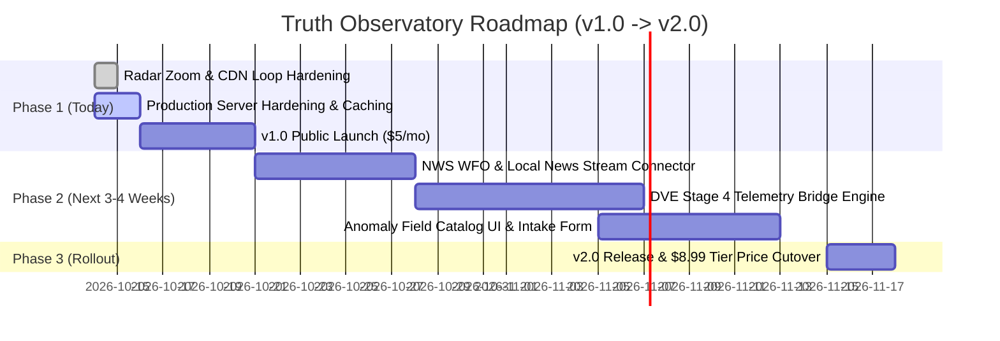

# Truth Observatory v2.0 & DVE Integration — Complete Master Blueprint
**Document ID:** `OBS-BLUEPRINT-2026-V2`  
**Classification:** Strategic & Architectural Specification  
**Architecture Doctrine:** Aligned to 42-Doctrine Deterministic Dissolution Ladder (Doctrines 1–17, 32, 42)  
**Target Repositories:** `D:\truth` (Observatory Backend & Frontend) & `D:\dve` (Deterministic Verification Engine)  
**Domains:** `observatory.tlid.io`, `dve.tlid.io`, `truth.tlid.io`

---

## 1. Executive Summary & Vision

Truth Observatory is transitioning from a passive physical telemetry cockpit into an active, **verifiable physical intelligence ecosystem**. This evolution consists of three primary pillars:
1. **Hyper-Local Emergency Grounding:** Connecting user ZIP-code locked spaces directly to their National Weather Service (NWS) Weather Forecast Office (WFO) and local television broadcast radar/emergency livestreams.
2. **Deterministic Verification Engine (DVE) Integration:** Embedding `dve.tlid.io` as the cryptographic verification backbone of Observatory to debunk hoaxes, detect synthetic media, and cross-reference physical anomalies against historical telemetry.
3. **Verified Anomaly Field Catalog:** A structured, searchable public/subscriber database of rare atmospheric and geological phenomena (Sprites, Asperitas, STEVE, ocean anomalies) where all submissions must pass the DVE intake pipeline before publication.
4. **Two-Tier Monetization Model:** Launching v1.0 now at **$5.00/month** (Founding Pioneer Tier, grandfathered for life), evolving to **$8.99/month** (Sentinel Research Tier) upon v2.0 DVE + Anomaly release.

---

## 2. Pillar 1: Local Emergency Weather Broadcast & DMA Connector

### 2.1 The Objective
When a user locks their ZIP code or geolocation in the Cockpit, the system must not only filter local telemetry, but also provide immediate, one-click access to **official meteorological intelligence** and **local broadcast emergency live coverage**.

### 2.2 Technical Architecture & APIs



#### Step 1: NWS Station Metadata Extraction
Endpoint: `GET https://api.weather.gov/points/{lat},{lon}`  
Response keys:
- `properties.cwa`: 3-letter WFO code (e.g., `ILN` = Wilmington/Cincinnati/Columbus, `RNK` = Blacksburg, `OUN` = Norman/OKC).
- `properties.forecastOffice`: URL to the WFO API resource.
- `properties.radarStation`: 4-letter NEXRAD radar identifier (e.g., `KILN`, `KCLE`, `KFDR`).
- `properties.timeZone`: Local time zone (e.g., `America/New_York`).

#### Step 2: Designated Market Area (DMA) & Local News Livestream Mapping
Create a deterministic mapping catalog in `observatory/lib/local-stations.mjs`:
```javascript
export const WFO_BROADCAST_REGISTRY = {
  ILN: {
    name: 'NWS Wilmington / Ohio Valley',
    dma: 'Cincinnati / Dayton / Columbus',
    wfoUrl: 'https://www.weather.gov/iln/',
    hourlyUrl: 'https://forecast.weather.gov/MapClick.php?lat={lat}&lon={lon}',
    broadcasts: [
      { name: 'WLWT News 5 (NBC)', url: 'https://www.wlwt.com/nowcast' },
      { name: 'WCPO 9 (ABC)', url: 'https://www.wcpo.com/live' },
      { name: 'WHIO 7 (CBS)', url: 'https://www.whio.com/live-stream/' }
    ]
  },
  IND: {
    name: 'NWS Indianapolis',
    dma: 'Central Indiana',
    wfoUrl: 'https://www.weather.gov/ind/',
    broadcasts: [
      { name: 'WTHR 13 (NBC)', url: 'https://www.wthr.com/watch' },
      { name: 'WISH-TV 8 (CW)', url: 'https://www.wishtv.com/live-stream/' }
    ]
  }
  // Generic fallback: NWS official office portal + Weather Underground local stream
};
```

#### Step 3: Emergency Action Bar in Cockpit
When an active polygon warning (Tornado Warning, Severe Thunderstorm Warning, Flash Flood Warning) intersects the user's locked coordinates:
- A high-visibility, pulsing alert banner renders at the top of the Cockpit:
  > `🚨 ACTIVE TORNADO WARNING IN YOUR COUNTY (EXP: 19:45 EDT)`  
  > `[WATCH LOCAL BROADCAST STREAM]  [NWS RADAR DISCUSSION]  [MUTE AUDIO CUE]`
- Web Audio API generates a subtle, low-frequency 440Hz -> 880Hz alert chime (configurable in settings, muted by default).

---

## 3. Pillar 2: Deterministic Verification Engine (DVE) Integration

### 3.1 DVE Overview & Doctrine
- **Doctrine Alignment:** Occupies **Doctrines 13–17** of the 42-Doctrine Ladder: **Constraint & Determinacy**.
- **Repository:** `D:\dve`
- **Current Stack:** Express 5 ESM backend, React + Vite Apex UI, PostgreSQL via Drizzle ORM, `yt-dlp`, `faster-whisper`, OpenCV frame analysis.
- **Core Principle:** DVE does not output subjective opinions or editorial verdicts. It outputs an **inspectable claim record** with timestamped telemetry cross-checks.

### 3.2 Four-Stage Verification Pipeline (Integrated with Observatory)



### 3.3 Stage 4: Observatory Correlation Logic
When DVE inspects an atmospheric or anomalous weather claim:
1. **Radar Check:** Queries `/api/feed/radar/archive?time={t}&lat={lat}&lon={lon}`. Did NEXRAD detect reflectivity? Was it meteorological precipitation, biological scatter (birds/insects), or ground clutter?
2. **Satellite Cloud-Top Check:** Queries GOES-East/West Band 13 (clean infrared) and Band 2 (visible). What was the cloud-top temperature and altitude? Was the formation standard cirrostratus or an anomalous plume?
3. **Lightning & Energy Check:** Queries NOAA GLM (Geostationary Lightning Mapper). Was optical energy detected in the column?
4. **Ionospheric Transmitter Check:** Queries HAARP / Poker Flat / Millstone Hill transmitter schedules. Were any high-frequency heaters transmitting during that window?
5. **Verdict Generation:**
   - `VERIFIED_PHYSICAL_EVENT`: Video matches physical sensor telemetry within ±5 minutes and ±10 km.
   - `NATURAL_PHENOMENON`: Video is real, but claim of "artificial / geoengineered pulse" is refuted by natural meteorological Doppler characteristics.
   - `SYNTHETIC_OR_TAMPERED`: Temporal inconsistencies, deepfake facial/audio markers, or generative AI artifacts detected.
   - `UNVERIFIABLE`: Telemetry unavailable (e.g. outside NEXRAD/GOES coverage) or source lacks verifiable timestamp.

---

## 4. Pillar 3: Atmospheric & Geological Anomaly Field Catalog

### 4.1 Concept & Value
Subscribers often observe rare, fleeting, or unexplained phenomena that traditional meteorological apps discard. The Anomaly Field Catalog turns subscribers into **verified field observers**, while ensuring zero hoax infiltration.

### 4.2 Taxonomic Structure
1. **Transient Luminous Events (TLEs):**
   - Red Sprites, Elves, Blue Jets, Gigantic Jets, Halos.
   - Cross-referenced against GLM strike clusters and thunderstorm tops.
2. **Anomalous Cloud & Wave Dynamics:**
   - Undulatus Asperitas, Kelvin-Helmholtz billows, Fallstreak (hole-punch) clouds, Pyrocumulonimbus, Noctilucent clouds.
   - Cross-referenced against atmospheric soundings and GOES moisture channels.
3. **Ionospheric & Upper Atmospheric:**
   - STEVE (Strong Thermal Emission Velocity Enhancement), Stable Auroral Red (SAR) arcs, geomagnetic storm pulsations.
   - Cross-referenced against Kiruna Schumann, ACE/DSCOVR solar wind, and NOAA Kp index.
4. **Marine & Hydrological:**
   - Milky Sea bioluminescence, rogue wave seismic signatures, coastal tide recessions.
   - Cross-referenced against NDBC ocean buoys and USGS coastal seismometers.
5. **Unclassified Anomaly Queue:**
   - Observations that passed strict DVE media authentication but lack standard physical classification.

### 4.3 Database Schema (`truth` PostgreSQL)
```sql
CREATE TABLE anomaly_entries (
    id VARCHAR(64) PRIMARY KEY, -- ano_<sha256_short>
    subscriber_id INTEGER REFERENCES subscribers(id),
    title VARCHAR(255) NOT NULL,
    category VARCHAR(64) NOT NULL,
    phenomenon_type VARCHAR(64) NOT NULL,
    observed_at TIMESTAMP WITH TIME ZONE NOT NULL,
    latitude NUMERIC(8, 4) NOT NULL,
    longitude NUMERIC(8, 4) NOT NULL,
    media_url TEXT NOT NULL,
    media_hash VARCHAR(64) NOT NULL,
    dve_report_id VARCHAR(64) NOT NULL,
    dve_verdict VARCHAR(32) NOT NULL,
    nws_wfo VARCHAR(8),
    telemetry_snapshot JSONB NOT NULL,
    status VARCHAR(32) DEFAULT 'verified',
    created_at TIMESTAMP WITH TIME ZONE DEFAULT NOW()
);

CREATE INDEX idx_anomaly_geo ON anomaly_entries(latitude, longitude);
CREATE INDEX idx_anomaly_category ON anomaly_entries(category);
CREATE INDEX idx_anomaly_time ON anomaly_entries(observed_at);
```

---

## 5. Pillar 4: Monetization, Packaging & Phased Rollout

### 5.1 Pricing Structure

| Tier | Price | Status | Inclusions |
|------|-------|--------|------------|
| **Founding Pioneer** | **$5.00 / month** | **Launch v1.0 (Active Today)** | Lifetime grandfathered rate. Full Cockpit, Radar Loop, NWS Warnings, Aircraft Tracker, Research Transmitters, Ecology Index, 24h CSV Exports. |
| **Sentinel Research** | **$8.99 / month** | **Launch v2.0 (In 4–6 Weeks)** | Everything in v1.0 + DVE Media Verification Workspace (5 full video audits/mo), Anomaly Field Catalog access & submissions, SMS emergency warnings, high-res telemetry downloads. |
| **Institutional / API** | **$49.00 / month** | **Phase 3** | Commercial API key, unlimited DVE checks, raw netCDF4 radar/satellite extracts. |

### 5.2 Implementation Roadmap



---

## 6. Production Hardening Checklist for Today (v1.0)

1. **ZIP Geocoding Hardening:** Replace external un-cached Nominatim calls in `/api/weather/alerts` with the internal cached `geocodeZip()` helper.
2. **Process Crash Immunity:** Add `uncaughtException` and `unhandledRejection` guards in `server.mjs`.
3. **Request Protection:** Wrap `createServer` handler in a root try/catch block to guarantee graceful 500 JSON responses rather than socket hang-ups.
4. **Tile Fallbacks:** Ensure Iowa State Mesonet fallback radar has `maxNativeZoom: 8, maxZoom: 19` so radar never drops out if RainViewer CDN latency spikes.
5. **Memory Cap:** Enforce LRU eviction caps on all in-memory caches (`zipCache`, `pointAlertsCache`, `nwsWarningsCache`).

---
*Authored by Antigravity AI for DarkWave Studios LLC · 2026*
