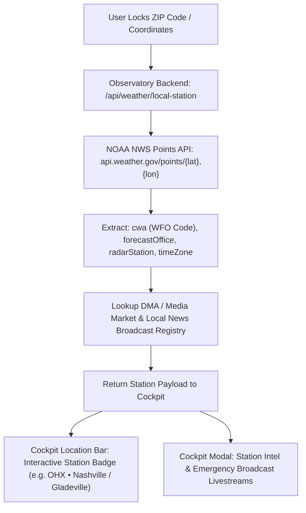
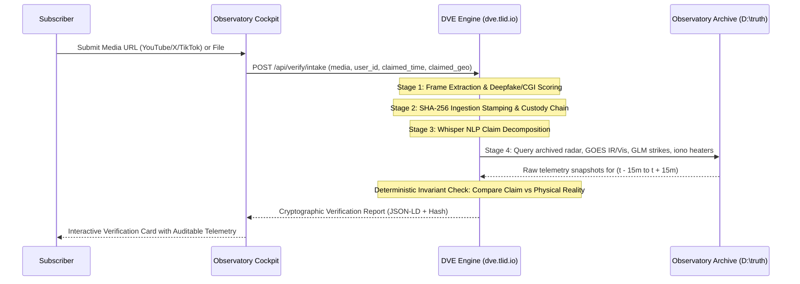
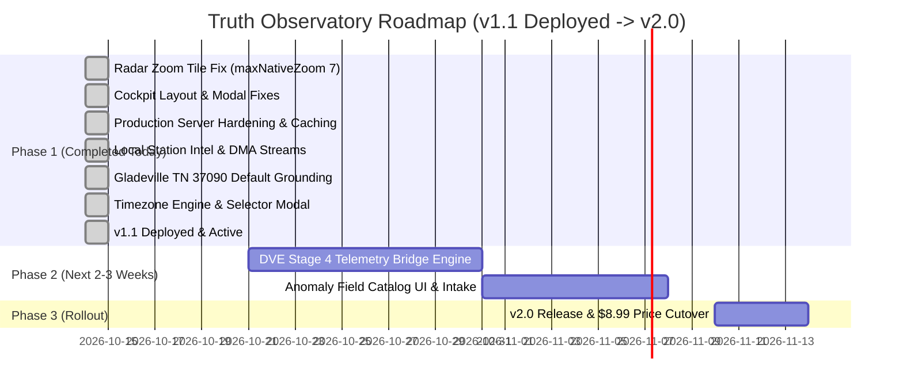

# Truth Observatory v2.0 & DVE Integration — Complete Master Blueprint
**Document ID:** `OBS-BLUEPRINT-2026-V2.1`  
**Classification:** Strategic & Architectural Specification  
**Architecture Doctrine:** Aligned to 42-Doctrine Deterministic Dissolution Ladder (Doctrines 1–17, 32, 42)  
**Target Repositories:** `D:\truth` (Observatory Backend & Frontend) & `D:\dve` (Deterministic Verification Engine)  
**Live Domains:** `observatory.tlid.io`, `dve.tlid.io`, `truth.tlid.io`  
**Operational Status:** **Phase 1 Production Hardened & Deployed (v1.1 Live)**

---

## 1. Executive Summary & Vision

Truth Observatory is transitioning from a passive physical telemetry cockpit into an active, **verifiable physical intelligence ecosystem**. This evolution consists of three primary pillars:
1. **Hyper-Local Grounding & Station Intel (SHIPPED & LIVE):** Connecting user ZIP-code locked spaces directly to their National Weather Service (NWS) Weather Forecast Office (WFO), single-site NEXRAD radar, and local television broadcast emergency livestreams.
2. **Temporal Engine & Timezone Calibration (SHIPPED & LIVE — Added in v1.1):** Standardizing the platform to the founder's home base in **Gladeville, TN 37090** (Central Time `America/Chicago`), while providing an interactive Timezone Selector for subscribers to customize telemetry clocks platform-wide.
3. **Deterministic Verification Engine (DVE) Integration (Next Phase):** Embedding `dve.tlid.io` as the cryptographic verification backbone of Observatory to debunk hoaxes, detect synthetic media, and cross-reference physical anomalies against historical telemetry.
4. **Verified Anomaly Field Catalog (Next Phase):** A structured, searchable public/subscriber database of rare atmospheric and geological phenomena (Sprites, Asperitas, STEVE, ocean anomalies) where all submissions must pass the DVE intake pipeline before publication.
5. **Two-Tier Monetization Model:** Launching v1.0/v1.1 now at **$5.00/month** (Founding Pioneer Tier, grandfathered for life), evolving to **$8.99/month** (Sentinel Research Tier) upon v2.0 DVE + Anomaly release.

---

## 2. Completed Today: Pillar 1 & Local Station Intel (PRODUCTION LIVE)

> **Status:** **100% Implemented & Deployed** (Accelerated from Phase 2 into today's release).

### 2.1 The Objective
When a user locks their ZIP code or geolocation in the Cockpit, the system must not only filter local telemetry, but also provide immediate, one-click access to **official meteorological intelligence** and **local broadcast emergency live coverage**.

### 2.2 Technical Implementation & Architecture



#### Implemented Components
1. **Station Registry (`observatory/lib/local-stations.mjs`):**
   - Curated registry of 25+ major US media markets and NWS WFOs (Nashville `OHX`, Cincinnati/Dayton `ILN`, Indianapolis `IND`, Cleveland `CLE`, Charleston `RLX`, Chicago `LOT`, Dallas `FWD`, Houston `HGX`, Atlanta `FFC`, New York `OKX`, Philadelphia `PHI`, Washington/Baltimore `LWX`, Pittsburgh `PBZ`, Miami `MFL`, Tampa `TBW`, Orlando `MLB`, St. Louis `LSX`, Kansas City `EAX`, Oklahoma City `OUN`, Denver `BOU`, Seattle `SEW`, Los Angeles `LOX`, etc.).
   - Includes direct links to WFO Portals, Area Forecast Discussions (AFD), single-site NEXRAD radar streams, and hourly graph soundings.
   - Includes verified live broadcast streams (e.g. WSMV 4 NBC, NewsChannel 5 CBS, WKRN 2 ABC, FOX 17 Nashville, WFAA Dallas, KPRC Houston, WSB Atlanta, etc.).
2. **REST API Endpoint (`observatory/server.mjs`):**
   - `GET /api/weather/local-station?zip={zip}&lat={lat}&lon={lon}`
   - Resolves coordinates via cached `geocodeZip()`, queries NOAA points API with fallback, and enriches station metadata.
3. **Cockpit UI & Interactive Modal (`cockpit.html` & `app.js`):**
   - Location bar features `#local-station-btn` with dynamic market pill.
   - Clicking opens `#local-station-modal` displaying official NWS links and one-click access to local newsroom live coverage during severe weather events.

---

## 3. Completed Today: Pillar 1.5 — Gladeville Standard & Temporal Engine (NEW)

> **Status:** **100% Implemented & Deployed** (Added to resolve local grounding and user timezone control).

### 3.1 Founder & Platform Standard Default: Gladeville, TN 37090
- **Home Base Grounding:** All clean browser sessions default to **Gladeville, TN 37090** (`lat: 36.12, lng: -86.26`), centering desktop, preview, and fullscreen maps at Zoom 7 with NWS Nashville (`OHX`, Radar `KOHX`) preloaded.
- **USPS / Postal District Override:** Standard postal databases catalog ZIP `37090` under Lebanon, TN. The backend (`geocodeZip` and `resolveLocalStation`) explicitly overrides `37090` and local Wilson County coordinates to correctly label and note the location as **Gladeville, TN 37090**.

### 3.2 Dynamic Temporal Engine & Timezone Selector Modal
- **Central Time Ecosystem Standard:** Default timezone across all telemetry clocks, radar frames, and ledger streams is set to **Central Time (`America/Chicago`)**.
- **Interactive Topbar Clock:** The `#utc-clock` element is now an interactive control button styled with hover highlights and dynamic timezone abbreviations (e.g. `20:20:15 CDT`).
- **Timezone Picker Modal (`#timezone-picker-modal`):**
  - **Standard Presets:** Central Time (Gladeville Default), Eastern Time, Mountain Time, Mountain Standard (Arizona - No DST), Pacific Time, Alaska Time, Hawaii-Aleutian Standard Time, and UTC Scientific Reference.
  - **Auto-Detection:** One-click option to auto-detect the user's browser timezone via `Intl.DateTimeFormat`.
  - **Custom IANA Input:** Allows advanced subscribers to input any valid IANA identifier (e.g., `Europe/London`, `Asia/Tokyo`) with instant syntax validation.
- **Platform-Wide Synchronization:**
  - **Event Ledger:** Event timestamps format in the active timezone (`HH:MM [TZ]`) with instant live re-render upon switching.
  - **Radar Animation Loop:** Loop indicator updates with real-time frame timestamps (e.g. `LIVE • 20:15 CDT` or `-20m • 19:55 CDT`).
  - **Meteorological Advisories:** Advisory expiration times display in active local time.
  - **Cross-Page Consistency:** `explorer.html` and `stream.html` respect user timezone preferences stored in `localStorage.getItem('observatory_timezone')`.

---

## 4. Completed Today: Production Hardening & Radar Fixes (SHIPPED)

> **Status:** **100% Implemented & Deployed**

1. **Radar Zoom Vanishing Fix:**
   - **Root Cause Identified:** RainViewer free composite radar tiles physically only exist up to Zoom 7. Zoom 8+ returns empty 1,370-byte transparent PNGs.
   - **Resolution:** Enforced `maxNativeZoom: 7, maxZoom: 19` across both desktop and fullscreen radar/precip layers. Leaflet now mathematically scales Zoom 7 tiles when zooming into county/neighborhood levels, eliminating radar disappearances.
   - **Fallback Protection:** Enforced `maxNativeZoom: 8, maxZoom: 19` on Iowa State Mesonet NEXRAD composites.
2. **Cockpit Layout & Filter Button Restoration:**
   - Discovered that an unclosed `<div class="level-menu" id="level-menu">` trapped `#weather-filter-modal` inside a `display: none` container.
   - Added closing tag, fully restoring the `⚙ FILTERS` button and interactive layers menu.
3. **Server Stability & Caching:**
   - Replaced un-cached client Nominatim calls with server-side cached `geocodeZip()`.
   - Added top-level process crash handlers (`uncaughtException`, `unhandledRejection`) in `server.mjs`.
   - Wrapped `createServer` in an outer error boundary to guarantee JSON 500 responses rather than dropped sockets.
   - Enforced memory limits with LRU eviction across all in-memory caches.
   - Bumped service worker cache to `observatory-v21`.

---

## 5. Next Phase: Deterministic Verification Engine (DVE) Integration

### 5.1 DVE Overview & Doctrine
- **Doctrine Alignment:** Occupies **Doctrines 13–17** of the 42-Doctrine Ladder: **Constraint & Determinacy**.
- **Repository:** `D:\dve`
- **Current Stack:** Express 5 ESM backend, React + Vite Apex UI, PostgreSQL via Drizzle ORM, `yt-dlp`, `faster-whisper`, OpenCV frame analysis.
- **Core Principle:** DVE does not output subjective opinions or editorial verdicts. It outputs an **inspectable claim record** with timestamped telemetry cross-checks.

### 5.2 Four-Stage Verification Pipeline (Integrated with Observatory)



### 5.3 Stage 4: Observatory Correlation Logic
When DVE inspects an atmospheric or anomalous weather claim:
1. **Radar Check:** Queries `/api/feed/radar/archive?time={t}&lat={lat}&lon={lon}`. Did NEXRAD detect reflectivity? Was it meteorological precipitation, biological scatter, or ground clutter?
2. **Satellite Cloud-Top Check:** Queries GOES-East/West Band 13 (clean infrared) and Band 2 (visible). What was cloud-top temperature and altitude?
3. **Lightning & Energy Check:** Queries NOAA GLM (Geostationary Lightning Mapper). Was optical energy detected in the column?
4. **Ionospheric Transmitter Check:** Queries HAARP / Poker Flat / Millstone Hill transmitter schedules. Were any high-frequency heaters transmitting during that window?
5. **Verdict Generation:**
   - `VERIFIED_PHYSICAL_EVENT`: Video matches physical sensor telemetry within ±5 minutes and ±10 km.
   - `NATURAL_PHENOMENON`: Video is real, but claim of "geoengineered pulse" is refuted by natural Doppler signatures.
   - `SYNTHETIC_OR_TAMPERED`: Temporal inconsistencies, deepfake facial/audio markers, or generative AI artifacts detected.
   - `UNVERIFIABLE`: Telemetry unavailable or source lacks verifiable timestamp.

---

## 6. Next Phase: Atmospheric & Geological Anomaly Field Catalog

### 6.1 Concept & Value
Subscribers often observe rare, fleeting, or unexplained phenomena that traditional apps discard. The Anomaly Field Catalog turns subscribers into **verified field observers**, while ensuring zero hoax infiltration.

### 6.2 Taxonomic Structure
1. **Transient Luminous Events (TLEs):** Red Sprites, Elves, Blue Jets, Gigantic Jets, Halos. Cross-referenced against GLM strike clusters and thunderstorm tops.
2. **Anomalous Cloud & Wave Dynamics:** Undulatus Asperitas, Kelvin-Helmholtz billows, Fallstreak (hole-punch) clouds, Pyrocumulonimbus, Noctilucent clouds.
3. **Ionospheric & Upper Atmospheric:** STEVE, Stable Auroral Red (SAR) arcs, geomagnetic pulsations. Cross-referenced against Kiruna Schumann, ACE/DSCOVR solar wind, and Kp index.
4. **Marine & Hydrological:** Milky Sea bioluminescence, rogue wave seismic signatures, coastal tide recessions.
5. **Unclassified Anomaly Queue:** Observations passing strict DVE media authentication but lacking standard physical classification.

### 6.3 Database Schema (`truth` PostgreSQL)
```sql
CREATE TABLE anomaly_entries (
    id VARCHAR(64) PRIMARY KEY, -- ano_<sha256_short>
    subscriber_id INTEGER REFERENCES subscribers(id),
    title VARCHAR(255) NOT NULL,
    category VARCHAR(64) NOT NULL,
    phenomenon_type VARCHAR(64) NOT NULL,
    observed_at TIMESTAMP WITH TIME ZONE NOT NULL,
    latitude NUMERIC(8, 4) NOT NULL,
    longitude NUMERIC(8, 4) NOT NULL,
    media_url TEXT NOT NULL,
    media_hash VARCHAR(64) NOT NULL,
    dve_report_id VARCHAR(64) NOT NULL,
    dve_verdict VARCHAR(32) NOT NULL,
    nws_wfo VARCHAR(8),
    telemetry_snapshot JSONB NOT NULL,
    status VARCHAR(32) DEFAULT 'verified',
    created_at TIMESTAMP WITH TIME ZONE DEFAULT NOW()
);

CREATE INDEX idx_anomaly_geo ON anomaly_entries(latitude, longitude);
CREATE INDEX idx_anomaly_category ON anomaly_entries(category);
CREATE INDEX idx_anomaly_time ON anomaly_entries(observed_at);
```

---

## 7. Monetization, Packaging & Updated Phased Roadmap

### 7.1 Pricing Structure

| Tier | Price | Status | Inclusions |
|------|-------|--------|------------|
| **Founding Pioneer** | **$5.00 / month** | **Live in Production (v1.1)** | Lifetime grandfathered rate. Full Cockpit, High-Res Radar Loop, Gladeville/Central default, Timezone Selector, Local NWS Station Intel, Local News Emergency Livestreams, Aircraft Tracker, Research Transmitters, Ecology Index, 24h CSV Exports. |
| **Sentinel Research** | **$8.99 / month** | **Phase 2 (In 3–4 Weeks)** | Everything in v1.1 + DVE Media Verification Workspace (5 full video audits/mo), Anomaly Field Catalog access & submissions, SMS emergency warnings, high-res telemetry downloads. |
| **Institutional / API** | **$49.00 / month** | **Phase 3** | Commercial API key, unlimited DVE checks, raw netCDF4 radar/satellite extracts. |

### 7.2 Updated Gantt Roadmap



---
*Authored by Antigravity AI for DarkWave Studios LLC · Updated 2026-10-14*
